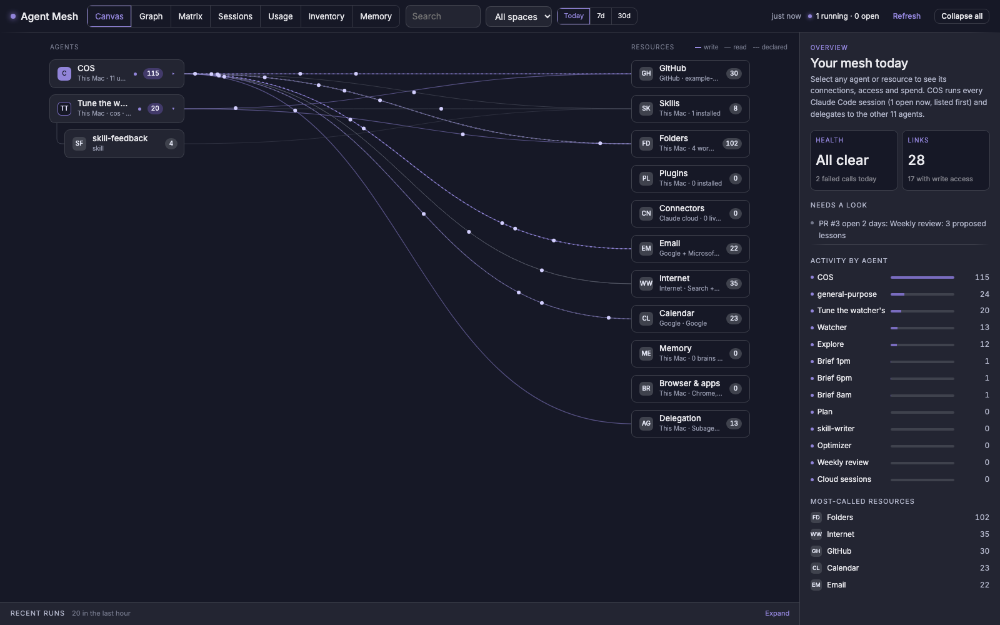
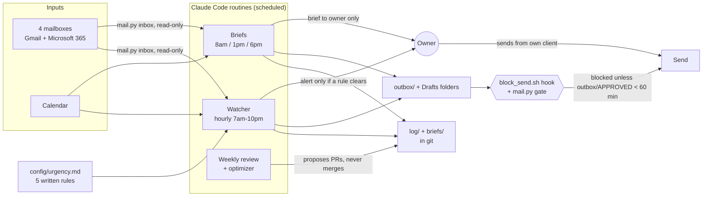

# Chief of Staff

[](https://github.com/anader298/chief-of-staff-agent/actions/workflows/test.yml)

A scheduled agent system, built on Claude Code, that reads four mailboxes and a calendar, writes three short briefs a day, checks every hour whether anything clears a written urgency bar, and prepares every outbound message as a draft. It cannot send. A hook outside the model blocks the send command unless the owner approved that draft in the last hour.

**Case study:** [dandoungroup.com/case-studies/#chief-of-staff](https://dandoungroup.com/case-studies/#chief-of-staff)

> **About this repo.** This is a public snapshot of a private system, live since 23 October 2026 and updated continuously: routines, urgency rules and skills change there first. The private repository holds real mail, so its history stays private; this copy was published as one commit on 11 November 2026, and every change since is its own commit. Mailboxes, people and every brief in it are synthetic.



*The Agent Mesh dashboard that watches the system, rendered from synthetic data (`dashboard/sample/make_sample.py`). No real session, mailbox or cost is shown.*

## The problem

One person was the bottleneck on a loop he was good at: read four mailboxes, decide what matters, research it, draft the reply, hand it up. Each mailbox had its own calendar and its own counterparties. Things fell through in predictable ways: offered call slots went stale, drafts sat unsent for days, the same ask came up again and again without action.

The loop worked. It did not scale. So the system copies the loop, and the hard part is deciding where the model is allowed to decide.

## What it does

- **Three briefs a day** at 8am, 1pm and 6pm, capped at 250, 200 and 200 words. Mail is bucketed Act (draft a reply), Read (one line) or Ignore (counted, not listed). Each brief carries a health line saying which mailboxes were read.
- **An hourly watcher**, 7am to 10pm, that is silent by default. It speaks only when a message clears one of five written rules: a recruiter or interviewer writing, a calendar change for today or tomorrow, a counterparty on a live deal, a document for signature, or a deadline inside 24 hours. Everything else waits for the next brief.
- **Drafts, never sends.** Every message to a third party is a markdown file in `outbox/` or a draft in that mailbox's Drafts folder. The owner sends it from his own mail client.
- **Two gates in code.** A Claude Code `PreToolUse` hook refuses any shell command that would send mail. Inside the mail tool, a second check refuses any recipient that is not one of the owner's own addresses. Both open only for an hour after the owner creates `outbox/APPROVED`.
- **It cannot edit its own rules.** When the owner says "not urgent", it proposes a diff to `config/urgency.md` and waits. A weekly review and a weekly optimizer propose changes as pull requests and never merge them.
- **Everything is recorded.** One log line per run, including every silent pass. Every brief and alert saved by date. The whole record in git.

## How it works

One agent definition (`agents/cos.md`) has two lives. As scheduled cloud routines it reads and reports. As an interactive Claude Code session on the desk it plans, delegates research to subagents, and drafts. The routines read; the person decides; a hook enforces the line between them.



| Piece | File | What it does |
|---|---|---|
| Agent | `agents/cos.md` | Standing orders, triage buckets, brief formats, voice |
| Routines | `routines/*.md` | The prompts the scheduled runs execute: three briefs, the watcher, the weekly review, the optimizer |
| Urgency bar | `config/urgency.example.md` | The five rules that let the watcher speak |
| Mail tool | `tools/mail.py` | Read inbox, create and list drafts, gated send. Gmail REST, IMAP or Microsoft Graph. Stdlib only |
| Send hook | `hooks/block_send.sh` | `PreToolUse` hook on Bash. Parses the program being run, not words in the command, and fails closed |
| Preflight | `tools/preflight.py` | Checks the delivered email body (hard wraps, stray markdown, round trip through the real builder) |
| Repo sync hook | `hooks/sync_repos.sh` | Fast-forwards the laptop clone before a session starts, so local sessions do not run yesterday's rules |
| Skill | `skills/skill-feedback/` | Turns a correction into a dated rule in the file that caused it, after showing the diff |
| Dashboard | `dashboard/` | Agent Mesh: which agents ran, what they touched, read or write, spend, health. See [dashboard/README.md](dashboard/README.md) |
| Secret scan | `tools/secret_scan.py` | Scans every added line in git history for keys and tokens, prints redacted hits |

## Stack

Claude Code (agents, skills, hooks, scheduled cloud routines, subagents). Python 3 standard library only for the mail tool, preflight and dashboard collector. Gmail REST API with OAuth, IMAP with an app password, Microsoft Graph for Microsoft 365. Bash for hooks. Vanilla JS and CSS for the dashboard. Git as the audit trail.

## Results

From the system's own log and saved briefs, 23 October to 8 November 2026:

| | |
|---|---|
| Scheduled briefs delivered | 46 over 16 days; 14 days with all three |
| Hourly watcher passes logged | 205 |
| Silent passes | 189 (92%), held for the next brief |
| Alerts raised | 11 in 17 days, each under a written rule |
| Average morning brief | 242 words against a cap of 250 (midday 191 and evening 200, against 200) |
| Drafts prepared for third parties | 19, each waiting for a person; 2 sent by the owner from his own mail client |
| Mailbox read failures | 0 across 194 health checks |
| Messages sent without approval | 1, on 26 October, by a bug in a gate being built; patched the same hour |

Time saved and running cost were not measured, so none is claimed.

## Where it breaks

- **A gate with a bug is not a gate.** While a new send command was being built, a header-parsing bug returned an empty recipient list, the empty list passed the gate, and a reply left with stale call slots attached. The gate now refuses an empty list (`test_empty_list_blocked`), and the agent has a standing rule never to test a send command on a real draft.
- **The urgency bar failed silently at first.** The routines could see one mailbox of four, so the rules about counterparties were dead text until forwarding existed. 57 of the first 60 passes were quiet. The log showed the silence; it did not show why. Each pass now logs a per-mailbox count and `FAILED:` names.
- **Clocks drift.** Every schedule was in UTC. When daylight saving ended, every routine fired an hour early, and the fix was asked for in fourteen briefs before it was made.
- **It nags.** The same expired item stayed on the list for four days. Repetition had to be designed out after the fact: an ask now drops to one "still open" line after three briefs.
- **Scope of this repo.** It covers mail and calendar. Readers for other channels are not included. Briefs, alerts and drafts are only as good as the model's reading of the mail; the gates stop it from acting, not from being wrong.
- **The hook is a pattern match.** `block_send.sh` knows the send tools it was written for. A new way to send mail needs a new line in the hook, which is why the mail tool carries its own gate as a second layer.

## Run it / adapt it

Requirements: Python 3.10+, bash, git, Claude Code. No pip installs.

```bash
# 1. config: copy the templates and fill them in (the real files are gitignored)
cp config/mailboxes.example.json config/mailboxes.json
cp config/urgency.example.md     config/urgency.md
cp config/people.example.md      config/people.md
cp config/workspaces.example.md  config/workspaces.md
cp .claude/settings.example.json .claude/settings.json   # wires the send hook and the sync hook

# 2. credentials: one OAuth consent per Gmail account; Microsoft 365 refresh tokens go in the same file
python3 tools/gmail_oauth_connect.py you@example.com     # writes ~/.config/cos/tokens.json (shape: config/tokens.example.json)
# for cloud routines, base64 that file into MAIL_ACCOUNTS_B64 and set GRAPH_CLIENT_ID in the environment

# 3. check the gates before anything else
python3 -m unittest discover -s tests -v

# 4. read mail, draft, never send
python3 tools/mail.py inbox --all --hours 12
python3 tools/mail.py draft --account C-work --to "someone@example.org" --subject "Re: call" --body-file reply.txt
```

Interactive: open Claude Code in this repo and say "CoS, ...". To reach it from any workspace, symlink `agents/` and `skills/` into `~/.claude/`.

Scheduled: create one Claude Code cloud routine per file in `routines/`, each with the prompt "Run routines/<name>.md", on these schedules in the owner's local time: briefs at 8am, 1pm and 6pm; the watcher hourly from 7am to 10pm; the weekly review on Sunday evening; the optimizer on Wednesday at 3am. Set the schedule in a time zone that follows daylight saving, or expect the drift described above.

Dashboard: `python3 -I dashboard/sample/make_sample.py` then `COS_DASH_NO_COLLECT=1 python3 -I dashboard/serve.py`.

To adapt it, change the rules, not the code: `config/urgency.md` decides when it speaks, `config/people.md` decides who matters, `agents/cos.md` decides what it may do. Keep both gates.

`examples/` holds a synthetic day: a morning brief, the one alert, the evening brief, the log lines and an outbox draft, all invented.

## Case study

The longer write-up, with the exhibits: https://dandoungroup.com/case-studies/#chief-of-staff


## Methodology

Use: Automate, with a Screen step. Lever: time and risk. It gives the principal back the hours spent in four inboxes, the briefs show a leader what needs a decision, and nothing leaves without approval.

| Step | Done by | Check |
|---|---|---|
| Run briefs (8am, 1pm, 6pm) and the hourly watcher | Code: Claude Code cloud schedule | One log line per run, silent passes included |
| Read mail and calendar | Code (`tools/mail.py`), read-only | Per-mailbox count and `FAILED:` line in every brief |
| Sort mail; judge urgency against five written rules | Model | Each alert names its rule; no labelled test set yet |
| Draft a reply | Model | Draft only |
| Send outside the owner's addresses | Person | `hooks/block_send.sh` and the recipient check in `mail.py`, open only for 60 minutes after `outbox/APPROVED` |
| Change its own rules | Model proposes, person approves | A diff or pull request only |

- **Playbook or agent, and why.** An agent, because triage has no fixed path. It holds private data, reads untrusted mail and could send, so sending is taken from the model and gated in code it cannot argue with.
- **How it was built.** On 26 Oct a header bug in a gate under construction passed an empty recipient list and one reply went out; the gate was patched that hour and `test_empty_list_blocked` covers it.
- **How it's checked.** 12 gate tests, passing on 18 Nov. The log from 23 Oct to 8 Nov: 205 watcher passes, 189 silent, 11 alerts each tied to a rule, 1 unapproved send.
- **Limits.** Triage judgment is unmeasured (next: a labelled inbox of 60 to 100 messages). A scheduled run could create the approval file, web fetch is ungated, and a fresh clone lacks the hook wiring. CI runs the gate tests on every push; its first Linux run caught a file-age bug in the hook, now fixed. See [Where it breaks](#where-it-breaks).

How I build with AI: [github.com/anader298/how-i-build-with-ai](https://github.com/anader298/how-i-build-with-ai)

## Author

Anthony Nader, Dandoun Group. Built and run daily to test how far an agent can be trusted when the boundary is enforced outside the model.

License: MIT.
