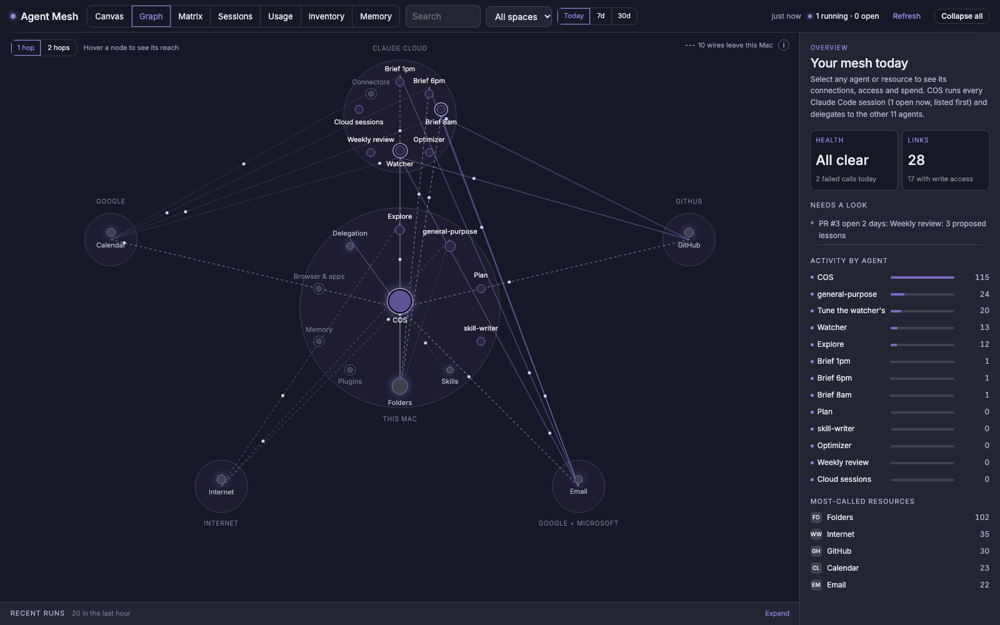

# Agent Mesh: a dashboard for the agent system

One page that shows which agents ran, what they touched, whether they wrote or only read, what it cost, and what needs a look. It reads Claude Code's own session transcripts on the laptop, the routine log in `log/`, and git. Stdlib Python for the collector, vanilla JS for the page, no build step.



## Run it on synthetic data

```bash
python3 -I dashboard/sample/make_sample.py              # fake transcripts -> the real collector -> dashboard/data/
COS_DASH_NO_COLLECT=1 python3 -I dashboard/serve.py      # http://127.0.0.1:8765/
```

`make_sample.py` writes made-up transcripts to a temp folder and runs them through the same `transcripts.Reader` and `build.build()` a real pass uses, so the sample exercises the real pipeline. Every title, count and dollar figure in the screenshots comes from it.

## Run it on your own sessions

```bash
cp dashboard/config.example.json dashboard/config.json   # workspaces, timezone, repo, private terms
./dashboard/serve.sh                                     # serves on 127.0.0.1:8765 and refreshes every 5 min
python3 -I dashboard/collect/tests/test_events.py        # collector tests
```

Wire `dashboard/refresh.sh` as a Claude Code `Stop` hook (see `.claude/settings.example.json`) and the data refreshes after every turn, at most once a minute, in the background.

## Views
Canvas (agents on the left, resources on the right, links by read or write), Graph (where each thing runs: this machine, the cloud, GitHub, Google), Matrix (who calls what), Sessions, Usage (API-equivalent spend), Inventory (every skill, agent, routine, connector, mailbox and hook, with use counts), Memory.

## What the collector does
- `transcripts.py` reads `~/.claude/projects/*/*.jsonl` and subagent transcripts incrementally: one byte offset per file, complete lines only, global dedupe on line, tool-call and message ids so resumed or copied sessions count once.
- `classify.py` maps each tool call to a resource and read or write. Only allow-listed fields leave it (skill name, subagent type, file path, mailbox, URL host). Never commands, queries or message bodies. Anything shaped like a key is redacted.
- `sources.py` reads routine runs from `log/YYYY-MM.md` lines (cloud routines are not in local transcripts), git commits, and the installed skills, agents, hooks and connectors.
- `build.py` spreads each session's cost over its messages, works out routine health (a watcher pass missed, a brief overdue, a log line with `FAILED:`), and writes `data/*.json`.
- `collect.py public` writes an allow-listed copy for publishing and refuses to write it if a leak check finds a home path, an email address, a session id, a key, or any term in `private_terms`.

## Limits
- Spend is API-equivalent, estimated from transcript cost lines. It is not a bill, and live sessions are estimates until they write a cost line.
- Cloud routine spend is not visible from the laptop; those rows show n/a.
- `data/` holds prompt previews and titles from real sessions. It is gitignored. Do not commit it.
